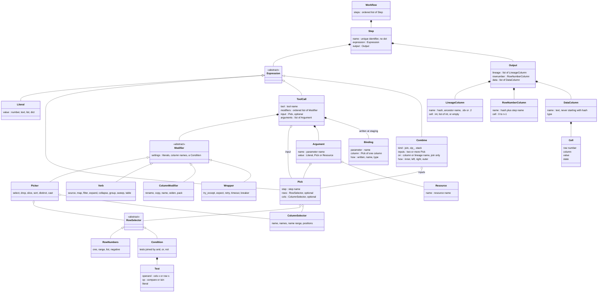
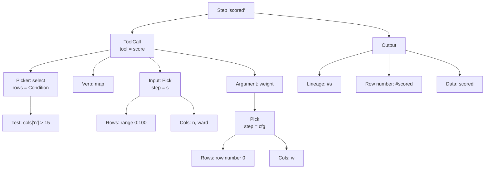
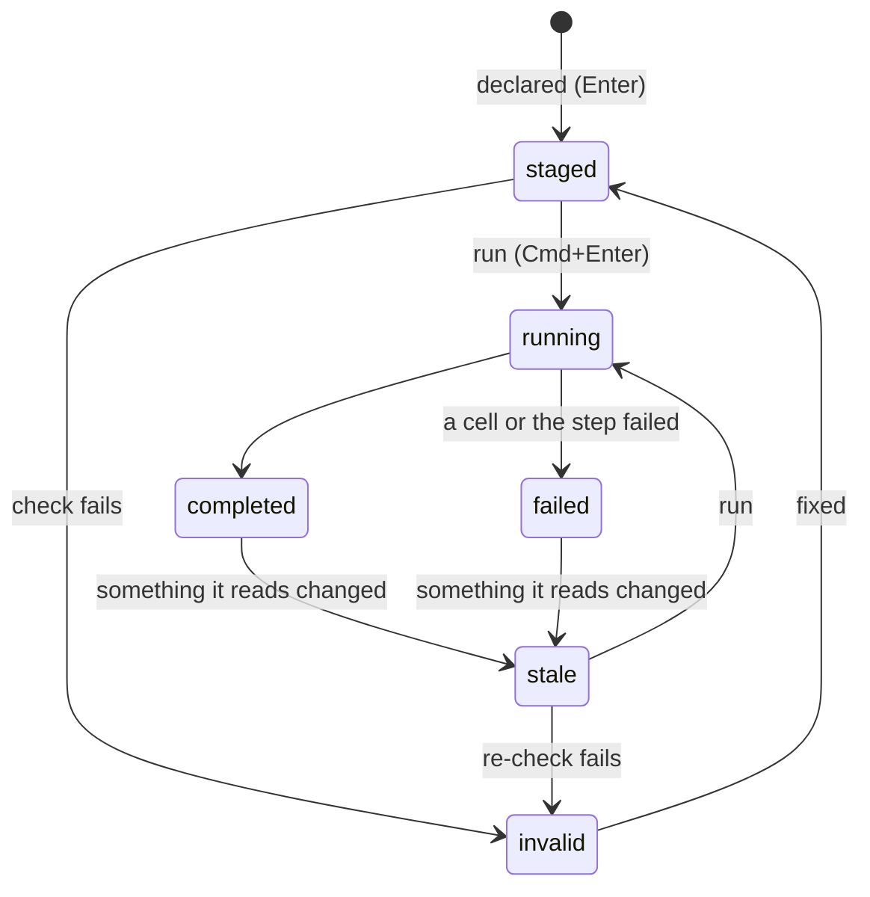
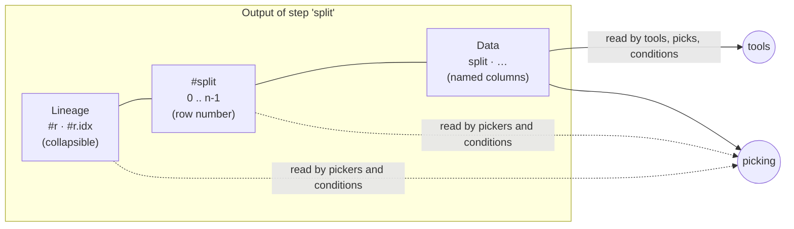
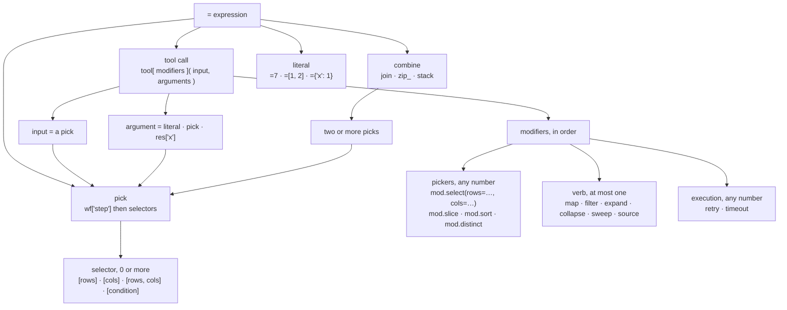
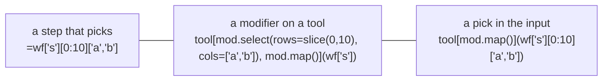

# The model and the ruleset

> The target for core: objects, definitions and rules for steps, picks,
> binding and lineage. Agreed by the owner, 2026-11-02, and revised the same
> day with the owner's answers to core's review (core's
> [`decisions.md` §0 and §4](../decisions.md#4-core-asks-reconciled-2026-11-02),
> IDs `N…`, `CA-…`). Nothing here is built yet; the work and its tests are in
> [plan.md](plan.md), and the order in core's
> [phase4-plan.md](../phase4-plan.md). IDs such as R1, T4 or H-R2 refer to the
> history in the app's `docs/dev_plan/130-reference-selection.md`. **This copy,
> in core, is the source** (N4).

## M0. The words

One word per idea. The right column lists the words this model retires.

| Word | Means | Retired |
|---|---|---|
| **workflow** | an ordered list of named steps | *pipeline* |
| **step** | a unique name, one expression, and the output it produces | *node*, *task* |
| **expression** | what a step does, as written: a literal, a pick, a tool call or a combine | *formula* |
| **pick** | part of an earlier step: `wf['s']` with up to one row part and one column part | *selection* |
| **row number** | a row's position in its step's output, `0..n-1`, shown as `#<step>`. Integers in a pick are row numbers, **as typed**: staging saves the row's lineage | *placement*, *row id* (as something shown or written) |
| **row id** | core's internal identity for a row, and already its lineage (`0.1`: item 1 of the parent's row 0; a group's key). Used for staleness, pairing and picks. Never shown, never written | — |
| **condition** | a test that keeps the rows it's true for, on data (`cols['x']`) or lineage (`row['s']`) | — |
| **lineage** | the `#<ancestor>` columns: for each ancestor step, the row number(s) this row came from | *`#v` column*, *trace column* |
| **aligned** | two steps whose rows are the same rows in the same order | *origin* |
| **modifier** | `mod.<name>(…)` in a tool call's brackets: a picker, a verb, a column modifier, or a wrapper | *orchestration*, *mode* |
| **picker** | a modifier that narrows or orders the input: `select`, `drop`, `slice`, `sort`, `distinct`, `cast` | *reshape* (for these) |
| **verb** | the one modifier that says how the tool is applied, and so what the output rows are | *shape verb* |
| **binding** | which column reaches which tool parameter; decided at staging and written into the expression | *bind by name* (as an implicit rule) |
| **combine** | `join`, `zip_` or `stack`: reads several steps | — |
| **pack** | columns into one dict cell; the way back from `widen`. (The owner's *squeeze*) | *squeeze* |

## M1. Summary

A **workflow** is an ordered list of named **steps**. Each step holds one
**expression** and produces an **output**: a table with three parts, kept
apart.

- **Lineage** (`#r`, `#split`, …) says which rows of each ancestor step each
  row came from. Every step carries its input's lineage, so every row maps
  back all the way.
- **`#<step>`** is the row number, `0..n-1`, in the step's current order.
- **Data** holds the named values. Only data reaches a tool.

An expression is a **literal**, a **pick** (part of an earlier step), a
**tool call**, or a **combine** of several steps. A pick reads like a list
and a dict: integers choose rows by row number, strings choose columns, a
condition chooses rows by value or by lineage.

A tool call is `tool[modifiers](input, arguments)`. Modifiers apply in the
order written: **pickers** narrow the input, **one verb** says how the tool
is applied, **column modifiers** rename, copy, widen or pack, and
**wrappers** handle retries, time and failures. **Binding** (which column
reaches which parameter) is decided at staging: what the user wrote, else a
column with the parameter's name, else the one column whose type fits, else
the step is `invalid` and says how to fix it. What staging decides, binding
and verb alike, is **written into the saved expression**, so the saved form
says exactly what runs.

Rows from different steps meet only where the expression says so: a
combine (on a value, or on lineage), or a pick. Nothing fails silently.

### What changed on 2026-11-02

| Before (first draft) | Now | Decision |
|---|---|---|
| columns bind to parameters by name, never by type | binding at staging: written, name, unique type, else `invalid`; saved explicitly; `mod.cast` for types | CA-A |
| only combines carry lineage forward | every step carries its input's lineage | CA-L1 |
| lineage cells are integers or lists | integers, lists, or empty | CA-L2 |
| renaming lineage is refused | `rename` on a `#` column copies, saved as `mod.copy` | CA-D |
| a pick matching nothing fails | a condition matching nothing gives zero rows and a warning; a row number out of range fails | CA-5 |
| join clashes refused | refused, except a column passed through unchanged from a shared ancestor | CA-C |
| a pick is a row number; "reference moved" when the row changes | typed as a row number, saved as the row's lineage, so it follows its row; core's lineage-based row ids stay its identity | CA-B1 (amended) |
| modifiers: pickers, one verb, execution | also column modifiers, error handling, expectation; written order is applied order; an inferred verb is never `filter` | N2, N3 |
| deleting a read step: refused or readers invalid | refused, naming readers; `k.remove(…, force=True)` deletes anyway | CA-6 |

## M2. Object model



## M3. Definitions

**Structure**

| Term | Definition |
|---|---|
| Workflow | An ordered list of steps. A step reads only steps before it |
| Step | A unique name (an identifier, no `.`), one expression, and the output it produces |
| Expression | What a step does. Exactly one of: literal, pick, tool call, combine |
| Literal | A fixed value: `=7`, `=[1, 2]`, `={'x': 1}`. Its output is one cell |
| Pick | Part of an earlier step: `wf['step']` followed by up to one row selector and one column selector |
| Tool call | `tool[modifiers](input, arguments)`: run a tool over an input |
| Combine | `join`, `zip_` or `stack` of two or more picks into one output |
| Empty step | A step with no expression yet: a 1×1 output holding `"empty"`. Not the same as zero rows |

**Inside a pick**

| Term | Definition |
|---|---|
| Row selector | Which rows: row numbers or a condition |
| Row number | A row's position in its step's output, `0..n-1`. Typed as an integer: `3`, `-1` (last). Staging resolves it to that row and the pick is **saved as the row's lineage**: back to its source row (`row['r'] == 2`), through an expand with `.idx`, through a collapse by its key (`cols['ward'] == 'A'`); into a source, sweep or table it stays a row number |
| Range | Rows `a` to `b-1`: `0:10`. In a modifier setting, `slice(0, 10)` |
| Row number list | Chosen rows in order: `[[0, 2]]` (`[0, 2]` is refused: rule 7) |
| Condition | A test that keeps the rows it's true for: `cols['n'] > 15`, `row['r'] == 3`, joined by `&`, `\|`, `~` |
| `cols['x']` (in a condition) | This row's value in data column `x`. Any name, identifier or not: `cols['Patient ID']` |
| `row['s']` (in a condition) | This row's row number in step `s`: its own `#s`, or its lineage `#s` if `s` is an ancestor. On a list cell, `==` means "contains" |
| Column selector | Which data columns: a name `'n'`, names `'a', 'b'` or `['a', 'b']`, a name range `cols['a':'c']`, or positions `cols[0:2]` |
| `rows[…]`, `cols[…]` | The explicit spellings of a row or column selector, for when the plain form would be unclear |

**Three ways to choose rows** (CA-B2)

| You want | Write | After a re-run |
|---|---|---|
| the row you see | `wf['s'][3]`: a click writes this; saved as its lineage (`wf['s'][row['r'] == 2]`) | the same row, wherever it is now; if it's gone, the step fails saying so |
| the row with this value | `wf['s'][cols['id'] == 'P-17']` | the same row, wherever it is |
| the rows from that ancestor row | `wf['s'][row['r'] == 3]`: offered from a lineage cell, never written by a click | the rows that came from r's row 3 |

**Inside a tool call**

| Term | Definition |
|---|---|
| Tool | A function; its typed parameters are what it reads |
| Modifier | `mod.<name>(settings)` in the brackets. Four kinds: picker, verb, column modifier, wrapper. **Written order is applied order** |
| Picker | Narrows or orders the input before the verb: `select`, `drop`, `slice`, `sort`, `distinct`. `cast` (`mod.cast(n='int')`) converts a column's type, before binding. Any number |
| Verb | How the tool is applied, and so what the output rows are. At most one; if none is written, staging infers it and writes it in. It never infers `filter`: dropping rows is always written (N2) |
| Column modifier | Changes columns, not rows: `rename` (moves a data column), `copy` (duplicates one; the only way lineage becomes data), `name` (names the tool's output), `widen` (a dict cell into columns), `pack` (columns into one dict cell). Before the verb it acts on the input; after it, on the output |
| Wrapper | Wraps each call, changes nothing about rows: `retry`, `timeout`, `breaker` (execution), `try_except` (what a failure becomes), `expect` (what staging promises). Shown in the expression if used: nothing is added unseen |
| Setting | A keyword inside a modifier: a literal, a column name as text (`by='ward'`, `by='#r'`), or a condition (`select(rows=…)`, `map(where=…)`) |
| Input | The positional argument: a pick, the rows the step works over |
| Argument | A keyword in `( )`: a literal, a pick, or a resource |
| Binding | Which column reaches which parameter (rule 14). Saved in the expression as keyword picks (`n=wf['s']['m']`) |
| Resource | `res['x']`: a live object (a model, a folder) a tool uses |

**The verbs**

| Verb | Calls the tool | Output rows | Lineage it adds |
|---|---|---|---|
| `source` | once, no input | what the tool returns | none: rows start here |
| `map` | once per row (`where=` skips rows, keeping them) | one per input row | none (one-to-one) |
| `filter` | once per row; keeps rows it approves | a subset, in order | `#<parent>`: an int |
| `expand` | once per row; each returns a list | one per item | `#<parent>` and `#<parent>.idx` |
| `collapse` | once per group (`by=`) | one per group, first appearance | `#<parent>`: a list |
| `group` | once per row; returns a key | one per input row, plus the key | none (one-to-one) |
| `sweep` | once per combination of settings | one per combination | none: rows start here |
| `table` | once, with the whole input | what the tool returns | none: the rows can't be traced one by one |

Pickers add lineage the same way: `slice`, `sort`, `select(rows=…)`, a row
pick and a condition add `#<parent>` (an int); `distinct` adds a list.
Column modifiers, `cast` and column picks add none.

**Inside an output**

| Term | Definition |
|---|---|
| Output | A table in three parts: lineage, row number, data |
| Lineage column `#<ancestor>` | One per ancestor step. A step carries every lineage column of its input, and a step that isn't one-to-one adds `#<parent>`. A cell holds the row number(s) this row came from, as they were when the step ran: an integer, a list of integers, or empty (a `stack` or outer `join` gap). Carried through a filter or sort it follows the kept rows; through an expand it repeats; through a collapse it becomes a list. An expand adds `#<parent>.idx`, the item's index within the parent's cell. The same ancestor twice is `#r`, `#r.2`. Read-only. Collapsed in the grid under "from r" |
| Row number column `#<step>` | This row's row number, `0..n-1` |
| Data column | A named column of values, with a type. Names are unique, non-empty text, never starting with `#`, kept as written (`'Patient ID'` too); numeric names become `var<n>`. An int column stays int when a value is missing |
| Cell | One value at (row number, data column), with a state: `known`, `absent`, `maybe`, `pending`, `blocked`, `failed`, `invalid` (core's states, CA-10) |
| Aligned | Two steps whose rows are the same rows in the same order: one step, or connected only through one-to-one steps |
| Row id | Core's internal identity for a row. Never shown or written |

## M4. The ruleset

**Hard rules** are enforced: breaking one refuses the expression or fails the
step, and is never silently reinterpreted. **Soft rules** give a warning or a
hint.

**Steps and expressions**

| # | Hard rule |
|---|---|
| 1 | Step names are unique; a step reads only steps **earlier** in the workflow. A reference to itself or a later step is refused |
| 2 | An expression is a literal, a pick, a tool call or a combine. Nothing else |
| 3 | The only way to refer to a step is `wf['step']`. A bare name or a string is never a reference |
| 4 | `wf['step']` on its own is a reference, not a step; to copy a step write `=wf['step'][:]` |
| 5 | Every output is a table; a single value is a one-cell table |

**Picks**

| # | Hard rule |
|---|---|
| 6 | Integers choose rows, by row number, as in a Python list. Strings choose columns, as in a dict. A row number is resolved at staging and saved as the row's lineage, written `wf['s'][rows[row['r'] == 2]]`, so a pick follows its row. **`rows[condition]` names specific rows: one that's gone fails the step, naming it; a plain `wf['s'][condition]` filters, and matching nothing gives zero rows (rule 11).** A list naming one row twice is refused |
| 7 | A pick has at most one row part and one column part, in either order, in one bracket or two. A list mixing integers and strings is refused; so are two integers in one bracket (`[0, 2]`), pointing to `[[0, 2]]` |
| 8 | A pick covers data only: never `#<step>` or lineage columns |
| 9 | A condition uses only `cols['x']`, `row['s']`, comparisons, `.isin`, `&`, `\|`, `~`, brackets and literals. It's read by the parser, never run as code |
| 10 | A condition reads the step it picks from: its data, its row numbers and its lineage. Values of another step need a combine first |
| 11 | A condition that matches nothing gives zero rows and a warning naming it. A row number out of range fails, naming it: a specific row was asked for. Zero rows is not the empty step |

**Tool calls**

| # | Hard rule |
|---|---|
| 12 | Modifiers apply in the order written. Any number of pickers, at most one verb, any number of column modifiers and wrappers. Pickers come before the verb; a column modifier before the verb acts on the input, after it on the output. No verb written: staging infers one and writes it in, never `filter` |
| 13 | The input is a pick. Every verb except `source` and `sweep` needs one, or keyword column picks from aligned steps (what staging writes) |
| 14 | **Binding is decided at staging**, per parameter, the first that decides: (1) what the user wrote, a keyword or a one-column input; (2) a column with the parameter's name, only for a parameter without a default; (3) the one unbound column whose type fits; (4) otherwise the step is `invalid`, naming the candidates (*"two int columns, a and b: write `n=wf['s']['b']`"*) or the type that doesn't fit (*"add `mod.cast(…)`"*). The binding is saved in the expression and never guessed again; one that breaks later makes the step `invalid`. Only lossless conversions are automatic (`int` → `float`); a failed cast fails the cell |
| 15 | Arguments are literals, picks or resources. A tool never receives a `#` column or a column name as text |
| 16 | What an argument pick passes is decided by the **verb**, never the parameter's type: one cell passes its value; a column under `map` / `filter` / `expand` passes each row's cell (only if the steps are aligned); under one call (`source`) the whole column as a list; under `collapse` the group's values. A type that doesn't fit is refused. A table passes only to a `DataFrame` parameter |
| 17 | Settings are literals, column names as text (`#` names allowed), or a condition in `select(rows=…)`. Never a pick or a resource |

**Combines**

| # | Hard rule |
|---|---|
| 18 | `join` pairs rows by a column's values (`on='ward'`) or by lineage (`on='#r'`: each child with its parent row) |
| 19 | `zip_` pairs row `i` with row `i`, and only for aligned steps |
| 20 | `stack` puts the inputs' rows one after another |
| 21 | A combine has one lineage column per input, and carries each input's lineage. The same ancestor twice (or by two paths) is numbered `#r`, `#r.2`. `join(a, b, on='#r')` works whenever one descends from the other; a column passed through unchanged from the shared ancestor appears once, not as a clash |

**Outputs and cells**

| # | Hard rule |
|---|---|
| 22 | Every output has `#<step>` = `0..n-1` |
| 23 | Lineage holds row numbers only (integers, lists of integers, or empty), never data. Every step carries its input's lineage; a step that isn't one-to-one adds one column for its parent; an expand adds `#<parent>.idx` |
| 24 | Data column names are unique text, never starting with `#`; unnamed or numeric names become `var<n>` |
| 25 | Lineage is read-only: never dropped or edited. It becomes data only by copying it into a new column: `mod.copy(columns={'#r': 'parent'})`. `mod.rename` on a `#` column copies too, and is saved as `mod.copy`. On data, `rename` moves a column and `copy` duplicates it |
| 26 | No silent results: a missing pair or a failed call is a failed or `absent` cell, or a refused step, never a null |
| 27 | The same text always means the same data, whatever the tool's types or the run state |
| 28 | **An output's columns are of two kinds, told apart by name.** A name starting with `#` is lineage or a row number, always `#` followed by a step name (`#r`, `#split`, `#r.2`). Every other name is data. In the grid, the lineage columns collapse and expand as a group |
| 29 | An int column stays int when a value is missing (a failed cell, a `stack` or `join` gap) |

| # | Soft rule |
|---|---|
| S1 | Many spellings are accepted; the grid, picks and hover always show the list/dict-style one (`wf['s'][0:10]['a', 'b']`) |
| S2 | Hover on a pick shows the cells it covers and what the tool gets: a value, a row's value, a list or a table |
| S3 | A pick saved as lineage shows, on hover, the row number it points at now |
| S4 | When staging decides something (a verb, a binding), the grid shows it as decided by core, not by the user, until the user edits it |
| S5 | The grid shows lineage (collapsed), `#<step>` and data apart. Each data header says whether the tool read it, the step made it, or it passed through |
| S6 | Clicking a lineage cell highlights the parent rows; it never writes a pick |
| S7 | A tool should read data through its parameters, not take a column name to look up |
| S8 | Lineage shows under an expander, collapsed to "from r", nearest parent first; picking by ancestor is offered from a lineage cell |

## M5. One expression as objects

`=score[mod.select(rows=cols['n'] > 15), mod.map()](wf['s'][0:100]['n', 'ward'], weight=wf['cfg'][0]['w'])`



Order of work: pick the input (rows 0–99, columns `n`, `ward`) → the picker
keeps rows with `n > 15` → `map` calls `score` once per row, with `n` bound by
name and `weight` the one cell → the output's `#s` records which row of `s`
each result came from.

## M6. Naming conventions and defaults

| Thing | Convention | Default | Rules |
|---|---|---|---|
| Step | `snake_case` noun for what the output holds: `readings`, `per_ward`, `scored` | the tool's name when created (`double`), then `double_2`, … | Unique. An identifier: no `.`, never `#`. Not a reserved name. Renaming rewrites everything core wrote: every `wf['old']`, the column named after the step, staging's bindings, `#old` downstream, `row['old']` |
| Tool | `snake_case` verb: `double`, `load_csv`, `score` | the function's name | Not a reserved name |
| Resource | `snake_case` noun: `llm`, `workspace` | — | Not a reserved name |
| Reserved names | `wf`, `res`, `mod`, `rows`, `cols`, `row`, `op`, `join`, `zip_`, `stack` | — | No step, tool or resource may use one |
| Data column made by a tool | `snake_case` | one value or one column: the **step's name** (core says `value` today); `mod.name('x')` sets it | A tool returning a dict: one column per key (today the dict stays in one cell). Unnamed parts: `var0`, `var1`, … unless renamed |
| Data column passed through (filter, sort, pick) | keeps its name | — | — |
| Data columns from a combine | keep their names | — | The same name from two inputs is refused, naming both; rename one first (`join`'s `on` column is the exception) |
| Numeric or empty name | — | `var<n>` | `0` and `'0'` both become `var0`; a clash is refused |
| Row number | — | `#<step>` | Always |
| Lineage | — | `#<parent>`; `#<parent>.idx` after an expand; `#<parent>.2` for the same parent twice | Always |

A data column whose name isn't a valid Python name (`'Patient ID'`,
`'2023-x'`) is kept as written, never renamed silently. It is picked by
string (`wf['s']['Patient ID']`, `cols['2023-x'] > 5`) and binds by keyword or
by type (rule 14), never by name.

A column named after its step by default follows the step when it's renamed.
A whole-step reference (`wf['pairs']`) to a step with several columns passes
them all: as an input they bind by name; as an argument to a one-value
parameter it's refused until one column is picked (`wf['pairs']['a']`).

## M7. An interactive session: editing steps and what changes downstream

Step states (core's names, run 2026-11-02):



| Edit | The edited step | Every step that reads it, directly or not |
|---|---|---|
| Change its expression (Enter) | re-checked: `staged` or `invalid`, old values kept until it runs | `stale`; old values kept, dimmed, with "changed upstream: <step>" |
| Run it (Cmd+Enter) | `running` → `completed` or `failed` | stay `stale` until run; "run stale" runs them in order |
| Change a source's data | `stale` | `stale` |
| A column a reader binds or picks disappears | — | `invalid` at once, naming the column (core today: `stale`, no problem, until run) |
| Rows move (row numbers shift) | — | `stale`; a pick follows its row (rule 6), or fails if the row is gone |
| Rename the step | references rewritten; output kept (a rename isn't a recompute) | what core wrote is rewritten (rule 14, M6); anything else that breaks is `invalid` with its reason, for the user to rename or redefine |
| Move the step | allowed only if every reader stays after it (rule 1) | — |
| Delete the step | refused while something reads it, naming the reader (core today); `k.remove(name, force=True)` deletes anyway | each reader `invalid`, naming the deleted step |

Rules for the session:

1. **Nothing is replaced silently.** A step's old values stay, dimmed and
   marked stale, until it runs again.
2. **The reason is always shown:** which upstream step changed, which column
   went missing, which picked row is gone.
3. **Checking is immediate; running is on request.** An edit re-checks every
   step downstream at once (cheap, no tools run); values change only when
   the user runs.
4. **Runs go in workflow order,** so a step never runs on a stale input.

## M8. Notes for later

- **Join variants.** Left, right and outer joins work in core today
  (`join(…, how=…)`). Merge is open. Lineage: one `#<input>` per side, empty
  where a side had no match. Today `join` adds `_left` / `_right` suffixes to
  clashing column names; the naming rules above refuse a clash instead,
  except a column passed through unchanged from a shared ancestor (rule 21).

---

# Worked examples

The model above, applied.

## What a step's output looks like



## The grammar



## Selectors: list and dict style

A plain bracket tells rows from columns **by type**: integers are rows,
strings are columns. `rows[…]` and `cols[…]` are the explicit spellings.

| Selects | List / dict style | Explicit |
|---|---|---|
| one row | `wf['s'][3]` | `wf['s'][rows[3]]` |
| rows 0–9 | `wf['s'][0:10]` | `wf['s'][rows[0:10]]` |
| rows 0 and 2 | `wf['s'][[0, 2]]` | `wf['s'][rows[[0, 2]]]` |
| last row | `wf['s'][-1]` | `wf['s'][rows[-1]]` |
| one column | `wf['s']['n']` | `wf['s'][cols['n']]` |
| two columns | `wf['s']['a', 'b']` or `wf['s'][['a', 'b']]` | `wf['s'][cols[['a', 'b']]]` |
| a block | `wf['s'][0:10]['a', 'b']` | `wf['s'][rows[0:10], cols[['a', 'b']]]` |
| a cell | `wf['s'][3]['n']` | `wf['s'][rows[3], cols['n']]` |
| rows by condition | `wf['s'][cols['n'] > 15]` | `wf['s'][rows[cols['n'] > 15]]` |
| rows by lineage | `wf['s'][row['r'] == 3]` | same |
| an expanded item | `wf['s'][row['r'].idx == 1]` | same |

Order is free (`wf['s']['n'][3]` is the same cell). Refused: a list mixing
numbers and strings (`[0, 'a']`), two row parts, two column parts.

## Conditions

One small grammar, the same in a selector and in `mod.select(rows=…)`:

| Part | Means |
|---|---|
| `cols['x']` | this row's value in data column `x` |
| `row['s']` | this row's row number in step `s`: its own `#s`, or its lineage `#s` if `s` is a parent |
| `row['s'].idx` | the item's index from `#s.idx`, after an expand |
| `==` `!=` `<` `<=` `>` `>=` | compare to a literal |
| `.isin([…])` | one of these |
| `&` `\|` `~` `( )` | and, or, not, grouping |

On a list cell (after a collapse), `row['r'] == 0` is true if the list
contains 0, `.isin` if any item matches, and `!=` is `~(==)`; `<` and `>` are
refused. Every test on an empty cell is false.

Nothing else: no function calls, no other names. The parser reads it; it's
never run as Python. The one exception is `slice(a, b)`, the spelling of a
row range inside `mod.select(rows=…)`, where `a:b` isn't valid Python.

## The same selection, three places



All three select the same cells. Picks and the hover always show the first,
list-style form. Pickers and picks can be mixed in one step; they apply in
order: input pick first, then each `mod.select`, then the verb.

## What an argument passes

| Verb | A column passed as an argument gives each call… |
|---|---|
| `map`, `filter`, `expand` | its own row's cell, whatever it holds (a list, if that cell is a list) |
| one call (`source`, no input) | the whole column, as a list |
| `collapse` | its group's values, as a list |

```
add_k[mod.map()](wf['r'], k=wf['r']['n'])       # each row's n            → 20, 40, 60, 80
total_of[mod.source()](k=wf['r']['n'])          # the whole column, once  → 100
total_of[mod.map()](wf['g2'])                   # cells hold lists: each summed
add_all[mod.map()](wf['r'], k=wf['r']['n'])     # refused: k is a list, each row's cell is an int
```

## Merging steps

| Write | Rows | Lineage |
|---|---|---|
| `=join(wf['a'], wf['b'], on='ward')` | matched by the column's values | `#a`, `#b` |
| `=zip_(wf['a'], wf['b'])` | row `i` beside row `i`; only if aligned | `#a`, `#b` |
| `=stack(wf['a'], wf['b'], wf['c'])` | one after another | `#a`, `#b`, `#c` |
| a combine of a combine | as above | the inner combine's own, and its lineage carried |
| `=join(wf['split'], wf['r'], on='#r')` | each child with its parent's data | `#split`, `#r` |
| `=join(wf['r'], wf['filtered'], on='#r', how='left')` | every row of `r`; `filtered`'s columns `absent` where it dropped a row | `#r`, `#filtered` |

Each input can be a pick: `join(wf['a'][0:10], wf['b']['ward', 'pop'], on='ward')`.

## The rules, short

1. A **reference** is `wf['step']` plus selectors. Nothing else refers to a step.
2. **Rows are row numbers**, `0..n-1`, like a Python list. Integers select rows.
3. **Strings select columns**, like a dict. `cols[…]` and `rows[…]` are the explicit forms.
4. **A condition chooses rows**, from data (`cols['x']`) or row numbers (`row['s']`).
5. **Tools receive data only**: never `#` columns, never column names as text. Which column reaches which parameter is decided at staging and saved in the expression.
6. **Pickers narrow the input; one verb applies the tool;** execution modifiers wrap the call.
7. **The same text always means the same data**, whatever the tool's types.
8. **Rows from different steps pair only when written:** `join` (on a value, or on lineage), `zip_` (aligned only), or a pick that names them.
9. **Every result is visible**: no match and no pair is a failed cell, never a silent null.
10. **Many spellings, one display**: any listed form is accepted; the grid and hover show the list-style one.
