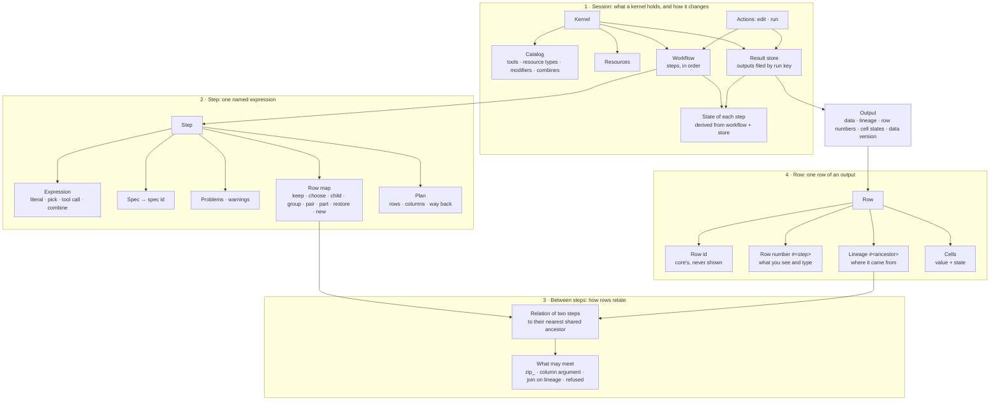

# The model, as a map

> The model in four layers, each built on the one below, and the behaviour we
> want from each, beside what core does today. Written 2026-11-03; every
> *today* was run at `2bd150e`. The rules in full are in [model.md](model.md);
> the open choices in [decisions.md](decisions.md).

## 1. The map



The same, as a tree:

```
Session
├─ Kernel
│  ├─ Catalog ............ what steps may use
│  ├─ Resources .......... live objects tools use
│  ├─ Workflow ........... the steps, in order (changed only by edits)
│  └─ Result store ....... every output, filed by run key = spec id + data read (added to only by runs)
├─ Actions ............... edit (re-checks at once, runs nothing) · run (makes a step current)
└─ States ................ derived: invalid · completed · failed · stale · staged

Step
├─ Expression ............ literal · pick · tool call · combine
│  ├─ Pick ............... a step + rows (row numbers or a condition) + columns
│  ├─ Tool call .......... tool [pickers · verb · column modifiers · wrappers] (input, arguments)
│  └─ Combine ............ join (on a value, or on lineage) · zip_ · stack
├─ Spec → spec id ........ what it is, as a hash; never data, never extras
├─ Problems, warnings .... why it can't run, or ran badly
├─ Row map ............... how each of its rows relates to its input's rows
└─ Plan .................. rows, columns and the way back, before it runs

Between steps
└─ Relation .............. each side's row map to the nearest shared ancestor:
                           same · subset · child · set · partial · none
   └─ decides ............ zip_ and column arguments (same only) · joins on lineage (one row each) · refusals

Row
├─ Row id ................ core's identity; follows the row; never shown
├─ Row number ............ 0…n-1 in the step's current order
├─ Lineage ............... the ancestor row(s) it came from: a number, a list, or empty
└─ Cells ................. a value and a state each
```

Read top-down, each layer only uses the one below it: the session stores
outputs and derives states from steps; a step's row map defines how its rows
relate to other steps'; relations are computed from rows' lineage.

## 2. What we want, layer by layer

**✓** today does what we want. **✗** it doesn't yet; the last column names the
decision or plan step that brings it.

### Rows

| | Write | We want | Today | |
|---|---|---|---|---|
| R1 | `wf["srt"][1]` (Ada), then Ada's temperature drops and `srt` re-sorts | the pick still gives Ada | saved as `wf["srt"][rows[row["v"] == 0]]`; gives Ada | ✓ |
| R2 | `wf["v"][0]` (Ada), then a row Zed is inserted at the top of `v` | the pick still gives Ada; its saved row number becomes 1 | gives **Zed**, `completed`, no warning | ✗ D-picks |
| R3 | `filter`, `expand`, `collapse(by="ward")` of `v` | each row's lineage names the rows it came from | `#v`: `[1]`; `[0, 0, 1, 1, 2, 2]` with `#v.idx`; `[[0, 2], [1]]` | ✓ |
| R4 | `mod.copy(columns={"#v": "parent"})`; a pick of `#v` | lineage becomes data only by copying; picking it is refused, pointing to the copy | `parent` = `[2, 0, 1]`; the pick refused: *"copy it into a data column first: mod.copy(…)"* | ✓ |

### Steps

| | Write | We want | Today | |
|---|---|---|---|---|
| S1 | `k["d"] = dbl[mod.map()](wf["v"])` | one output column, named after the step: `d` | `value` | ✗ plan S4 (CA-D2) |
| S2 | an `expand` whose tool returns `[]` for Ben | Ben gives no rows | Ada's and Cy's rows only; `#v` `[0, 2]` | ✓ |
| S3 | `count[mod.collapse(by="ward")](wf["v"])` | one row per ward, the key kept as a column | `ward` `[A, B]`, `value` `[2, 1]` | ✓ |
| S4 | a `map`, an `expand`, before running | the plan says the rows and columns, and what isn't known yet, and why | `map`: rows exact (3), columns exact `["d"]`; `expand`: rows unknown, *"how many items two returns per row is only known by running"* | ✓ |
| S5 | `add(a: int, b: int)` over columns `x`, `y` (both int) | `invalid`, naming both candidates and the fix: *write `a=wf["t"]["x"]`* | `invalid`: *"add() needs 'a', 'b', which 't' does not have"* | ✗ plan S3 (CA-A) |

### Between steps

| | Write | We want | Today | |
|---|---|---|---|---|
| B1 | `zip_(wf["v"], wf["d"])`, `d` computed from `sort(v)` | each row beside its own: same rows, any order | Ada 37.0 with 74.0, Ben 38.5 with 77.0, Cy 36.9 with 73.8 | ✓ |
| B2 | `zip_` of `v` and something computed from `filter(v)` | refused: some rows have no partner; the join written | refused, *"some would have no partner. Join them: join(…)"* | ✓ |
| B3 | a child reads its parent's column: `tag[map](wf["e"], temp=wf["v"]["temp"])` | refused, writing `join(wf["e"], wf["v"], on="#v")` | refused, writing the join | ✓ (D-child: keep) |
| B4 | `join(wf["c"], wf["v"], on="#v")`, `c` a collapse | refused, writing the unpack `mod.expand(columns=["#v"])` | refused, writing the unpack | ✓ |
| B5 | `zip_` of two unrelated sources; then with `match_ids=True` | refused; vouched, paired by id | refused; vouched, `completed` | ✓ |

### Session

| | Do | We want | Today | |
|---|---|---|---|---|
| X1 | an edit to `v` removes a column `f` reads | `f` is `invalid` at once, naming the column, **still showing its last values** | `invalid` at once, naming the column; its values **dropped** | ✓ (SM, 2026-11-03) |
| X2 | the column put back, data as `f` last ran on | `f` is `completed` again, no re-run | `staged`: must re-run | ✓ (SM, 2026-11-03) |
| X3 | `v` assigned the identical data again | nothing goes stale | `f` stays `completed` | ✓ |
| X4 | `f`'s expression changed, then put back exactly as it ran | `f` is `completed` | `stale` (*"updated args"*) | ✓ (SM, 2026-11-03) |
| X5 | `v` changes; `run("g")`, where `g` reads `h`, which reads `v` | `h` runs first, then `g` on fresh data: run makes a step current | `g` computed from `h`'s outdated values and shown `completed`, with a warning naming `h` and the version read; `h` still `stale` | ✗ SM |
| X6 | `v` changes; ask `h` why it's stale | the reason among its warnings, where the app reads | `stale`; the reason only in output metadata, warnings empty | ✗ SS7 |
| X7 | delete `h`, which `g` reads | refused, naming `g`; deleting anyway makes `g` `invalid`, naming `h` | refused, naming `g`; no delete-anyway | ✓ / ✗ SS7 |

**Today:** 13 of the 21 examples did what we want at `2bd150e`; X1, X2 and X4
since the result store (2026-11-03), so 16. Of the other 5: one is a silent
wrong answer (R2, D-picks); one is the session model's run (X5); three are
unbuilt (S1 naming, S5 binding, X6 the stale reason's place), with X7's
delete-anyway. The rows, steps and
between-steps layers hold; the session layer is where the work is.
